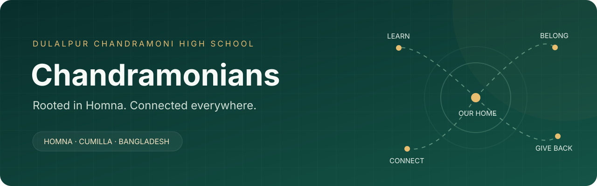

  

  <strong>One school. Many generations. A community that gives back.</strong> 
  Dulalpur Chandramoni High School · Homna, Cumilla · Bangladesh

  <a href="https://www.chandramonians.com/">Visit Chandramonians</a> ·
  <a href="https://www.chandramonians.com/members/">Meet our members</a> ·
  <a href="https://www.chandramonians.com/directory/">Find your community</a> ·
  <a href="docs/COMMUNITY_ROADMAP.md">Explore what’s next</a>

  
  
  
  

## A shared home for Chandramonians

Chandramonians connects the students, graduates, teachers, and association members
of Dulalpur Chandramoni High School. It brings school memories, learning resources,
community news, and membership information into one place—whether you live near
Homna or carry your school community with you somewhere else.

## Connect · Learn · Contribute

| Connect with your people | Keep learning | Give back together |
| :--- | :--- | :--- |
| Find alumni by batch and profession | Explore subject-based study resources | Discover association members |
| Browse Life and General membership lists | Practice daily challenges | Follow school and community events |
| Meet the association committee | Build learning streaks and earn XP | Share memories through the gallery |
| Reconnect through alumni profiles | Use an AI study assistant when configured | Stay informed through community news |

## Inside the platform

### A community you can find

- **Alumni directory** with batch filters, profile details, professions, and organisations.
- **Association member directory** with Life and General categories, name search, and batch filters.
- **Our home in Homna** with an interactive map that loads on request and a location pulse that respects reduced-motion settings.
- **Community identity** rooted in DCMHS, with English and Bangla language support.

### A school community that stays active

- **News and notices** with categories and publication controls.
- **Events** with upcoming and past activities, locations, and registration links.
- **Photo gallery** for school memories, reunions, and association activities.
- **Committee profiles** introducing the people helping the association grow.

### Learning beyond the classroom

- **Student study hub** with subject-based exam suggestions and learning materials.
- **Daily challenges**, progress tracking, XP, streaks, and a leaderboard.
- **AI tutoring** for explanations and study support when a provider is configured.

### Tools that keep the community running

- **Role-based spaces** for students, alumni, staff, and the association team.
- **Membership applications and payment records**, with filters and CSV exports.
- **Google Sheets integration**, plus Excel and CSV imports for existing membership lists.
- **Protected automation endpoint** for scheduled membership sync through an external scheduler such as n8n; configuration is required.
- **Persistent PostgreSQL storage** for the live site, with Django and Jazzmin administration.

> Membership lists and alumni profiles serve different purposes. A name imported
> from the membership sheet does not automatically become an alumni login or profile.

## The next chapter

These are planned improvements, rather than completed features:

| Direction | What it could bring to Chandramonians |
| :--- | :--- |
| **Alumni connections on the map** | Voluntary city-level connections from Homna to Bangladesh and the wider diaspora |
| **Mentorship that follows through** | Applications, matching, meeting reminders, and feedback |
| **Opportunities close to home** | Reviewed jobs, internships, skills sessions, and scholarship notices |
| **Useful news, chosen by people** | An editorial inbox with sources, local relevance, expiry dates, and manual approval |
| **Community impact** | Scholarship campaigns, volunteer coordination, attendance, and impact reporting |
| **Thoughtful automation** | n8n workflows for imports, review queues, reminders, and committee reports |

The existing job-board page is a placeholder, and the mentorship form does not yet
save applications. The [community roadmap](docs/COMMUNITY_ROADMAP.md) sets out how
to turn these starting points into working programmes, with research sources and
priorities tailored to rural Homna.

## Built with

**Django · PostgreSQL · Bootstrap · HTMX · Alpine.js · Jazzmin · Leaflet · Google Sheets**

The project uses a responsive, server-rendered interface, with interactive elements
where they help people find information and take part.

  <strong>Rooted in Homna. Connected across generations.</strong> 
  <a href="https://www.chandramonians.com/">Come home to Chandramonians →</a>

