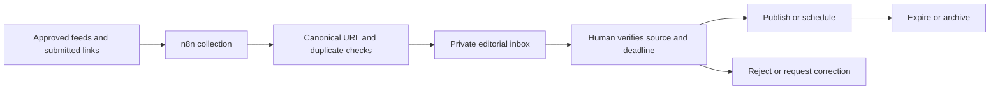

# Chandramonians: the next chapter

Research reviewed on 17 October 2026. These are recommendations for a rural
school community in Homna, Cumilla, rather than claims that every feature exists.
Priority should follow member interviews, available volunteers, and operating cost.

## What the project has today

Directories, membership imports, news, events, gallery, committee profiles,
student resources, learning challenges, and role-based dashboards already exist.
The project now includes a home-area map, safer account creation/login, a protected
scheduled-sync endpoint, and a controlled restoration path. The public redesign
adds larger-text and motion controls, real member previews, and a working guest
teaching/seminar/volunteer management flow with private applications and recorded
activity outcomes.

The job board is a placeholder. The mentorship form currently displays a success
message without saving an application. RSS headlines currently appear without
editorial approval. These gaps should be visible in planning and acceptance tests.

## Learn from alumni networks, then adapt locally

Alumnifire combines searchable directories, jobs, events, mentoring, and affinity
groups. For Chandramonians, the useful adaptation is a batch network that helps
someone find a trusted alumnus, a learning opportunity, or a way to contribute.
Do not build every social-network feature at once.
[Alumnifire product reference](https://www.alumnifire.com/)

CASE measures alumni engagement through communications, experiences, volunteering,
and giving. Use those four views to make contributions such as mentoring and
helping organise an event visible alongside donations. Its university benchmarks
are not performance targets for a rural high school.
[CASE engagement framework and 2026 discussion](https://www.case.org/resources/alumni-engagement-isnt-nice-have-its-core-business)

## Recommended order

| Priority | Deliverable | Why it matters here | Acceptance evidence |
| --- | --- | --- | --- |
| First | Stable member identity, import history, profile claiming | A restored sheet should remain reliable after reordering or editing | Same Member ID survives sorting; duplicates are reviewed; retries do not duplicate rows |
| First | Supported Django release, stronger admin access, durable media and backups | Community operations depend on reliable accounts and recoverable data | Tested upgrade, restore exercise, MFA for admins, uploaded photos survive deployments |
| Next | Bangla-friendly profile completion and batch representatives | Volunteers can help alumni who are less comfortable with online forms | Verified contact consent, representative review, mobile completion testing |
| Next | Editorial news and opportunities inbox | Students need trustworthy local information with deadlines | No aggregated item goes public before approval; expired notices leave the active feed |
| Next | Persisted mentorship applications and reviewed job posts | Turn existing placeholder pages into useful services | Application is saved, assigned, acknowledged, and followed up |
| Later | Event RSVP/check-in, volunteer tasks, scholarship campaigns | Create reasons to return and show tangible benefit | Attendance and volunteer completion recorded; campaign receipts reconciled |
| Later | Consented alumni city map and committee analytics | Help alumni find local connections and improve planning | No individual location without consent; dashboard decisions have defined metrics |

## Map direction: home first, connections over time

The country-level Alumni Map is now implemented at `/alumni-map/`. Every active
registered alumnus is listed; country markers appear only with profile consent.
The finer city-level connections below remain a future extension. Small profile
avatars now use durable PostgreSQL storage; larger media still needs object storage.

The first version shows the **Homna home area**, with an optional interactive
basemap and a restrained pulse. It loads on request to reduce the initial mobile
download. The administrative location is approximately `23.66, 90.79` from
[GeoNames](https://www.geonames.org/7645492/homna-upazila.html); it is not an exact
school-campus pin. Confirm a school map pin with the committee before using one.

For the next version:

1. Start with Homna → Cumilla → Bangladesh, then offer a wider connections view.
2. Let members voluntarily choose their current city and visibility. Use a city
   centroid, never a home address or a phone-derived location.
3. Draw a short animated arc from Homna only after selecting a consenting city.
   Give motion a stop point and respect reduced-motion preferences.
4. Cluster by city; suppress tiny groups where people could be identified.
   Display counts only when backed by actual consented records.
5. Support keyboard controls, readable labels, an accessible list alternative,
   and an ordinary map link if scripts or tiles cannot load.

Leaflet is sufficient for this lightweight first map. Consider MapLibre if many
city clusters and animated paths make WebGL useful. Both still need an appropriate
basemap service, attribution, and a plan for traffic; OpenStreetMap's public tile
service is not an unlimited production CDN.
[Leaflet guidance](https://leafletjs.com/examples/quick-start/),
[MapLibre line animation](https://maplibre.org/maplibre-gl-js/docs/examples/animate-a-line/),
[OpenStreetMap tile policy](https://operations.osmfoundation.org/policies/tiles/)

## Admin workspace improvements

Use a task-oriented landing screen: **Pending memberships**, **Import issues**,
**News awaiting review**, **Upcoming events**, and **Scholarship decisions**.
Each count should open the filtered work list, rather than require another search.

| Workspace | Recommended controls |
| --- | --- |
| Membership | Verification queue; stable Member ID; duplicate review; batch representative; profile-claim approval; private contact visibility |
| Treasury | Payment-to-member link; receipt/reference; reconciliation; correction reason; approval for financial edits; aggregate public impact |
| Imports | Source tab; start/finish time; added/updated/skipped/failed counts; row error export; preview before applying; last successful run |
| Editorial | Source allowlist; inbox; Bangla/English summaries; category; audience; reviewer; publish/unpublish/schedule; expiry and corrections |
| Events | RSVP capacity; reminders; check-in; accessible location; attendance; volunteer assignments |
| Mentorship | Consent; expertise; applications; matching; meeting status; feedback; safeguarding process for student interactions |
| Governance | Scoped groups; privileged-action audit trail; MFA; export permissions; documented recovery owner |

Keep the existing Jazzmin admin while adding workflow screens with Django/HTMX.
Use Django model permissions inside **every** privileged view; changing the menu
alone does not restrict access. The current HOD role is broad and should later be
split into Membership, Treasury, Editorial, Events, and Education permissions.

## Useful news with manual control

Prioritise **SSC/HSC deadlines, scholarships, admissions, training, verified local
opportunities, school notices, and community-service announcements**. Start with
the [Cumilla Education Board's official notices](https://comillaboard.portal.gov.bd/pages/notices),
the school's approved notices, and committee-reviewed sources. Use published feeds
or authorised APIs; use manual link submission when a source has no suitable feed.

Suggested `NewsSource` and `NewsSubmission` records: source URL, canonical item
URL, original publication date, fetched date, category, relevance to Homna,
short attributed summary, deadline, reviewer, review state, publication date,
and expiry. Store an optional AI summary as a draft with provenance. Verify it
against the original, especially dates, eligibility, phone numbers, and money.
Use brief summaries and links rather than copying whole articles.

n8n can schedule polling and read RSS. Those capabilities support collection;
the approval workflow is an application design proposed here.
[Schedule Trigger](https://docs.n8n.io/integrations/builtin/core-nodes/n8n-nodes-base.scheduletrigger/),
[RSS Read node](https://docs.n8n.io/integrations/builtin/core-nodes/n8n-nodes-base.rssfeedread/)

## Automation worth building

| Workflow | Trigger → action | Human control |
| --- | --- | --- |
| Membership refresh | Schedule → protected Django sync → aggregate run log | Stop on import errors; review identity conflicts |
| News collection | Schedule/RSS → deduplicate → editorial inbox | Editor approves every public item |
| Event reminders | Approved event → opted-in recipient list → reminders | Coordinator previews recipients and wording |
| Mentorship follow-up | New application → assigned coordinator → reminder | Coordinator verifies and matches participants |
| Committee briefing | Weekly schedule → aggregate metrics → draft report | Treasurer/committee checks conclusions |
| Reliability | Failed sync or stale data → maintainer alert | Bounded retries, escalation owner, manual rerun |

Use n8n Cloud or a separate maintained server. Store secrets in credentials,
publish scheduled workflows, set timezone to Asia/Dhaka, and use authenticated
HTTPS endpoints. Add idempotency keys, bounded retries, error workflows, and
minimum-data execution logs. The protected sync endpoint exists; the other
workflows and their endpoints are proposals. No outgoing messages are enabled.
[n8n hosting](https://docs.n8n.io/hosting/),
[Webhook authentication](https://docs.n8n.io/integrations/builtin/core-nodes/n8n-nodes-base.webhook/)

## Data that helps the committee decide

| Question | Metric and definition | Possible action |
| --- | --- | --- |
| Which batches are underrepresented? | Verified/contactable profiles divided by an agreed batch roster; show unknown denominator explicitly | Ask a batch representative to help |
| Are members returning? | Distinct members taking a meaningful action in 30 days, divided by eligible members | Improve opportunities and reminders |
| Is mentorship useful? | Accepted matches, completed meetings, and participant feedback | Recruit mentors in unmet subjects |
| Are events reaching people? | Actual attendees divided by RSVPs, segmented only where groups are large enough | Adjust date, transport, or format |
| Are funds reconciled? | Confirmed receipts, unresolved entries, allocations, and disbursements | Resolve exceptions before planning spending |
| Which notices help? | Opens of original links and explicit usefulness feedback; avoid equating views with outcomes | Keep useful categories and sources |
| Is automation reliable? | Last successful sync, record freshness, failure rate, and skipped rows | Fix the source or assign manual follow-up |

Start with Django aggregates and the existing charts. Add Metabase over a separate
read-only database account or curated aggregate views when the committee needs
exploration and scheduled reports. Review report recipients carefully: subscription
content uses the creator's data permissions. Do not expose private finance or
contact tables through public dashboards.
[Metabase subscriptions and permissions](https://www.metabase.com/docs/latest/dashboards/subscriptions)

## Technology and community guardrails

- **Upgrade baseline:** plan a tested migration from unsupported Django 5.1 to a
  currently supported release, with 5.2 LTS a candidate after dependency checks.
  Do not combine that framework upgrade with the emergency data restoration.
  [Django supported versions](https://www.djangoproject.com/download/)
- **Reliable media:** use an object-storage backend for profile/gallery uploads;
  keep database and object-storage backups and test restoration.
- **Rural access:** test on ordinary Android phones, slow connections, Bangla
  text, long names, and large touch targets. Keep essential information usable
  without animations; cache public resources rather than personal account data.
- **Consent:** separate public profile fields from private phone/email/payment
  details; make city-map participation voluntary. Review existing public payment
  fields with the committee before extending publication.
- **Financial identity:** replace first-name payment matching with a verified
  member relationship before relying on individual payment statements.
- **Community value:** offer batch memories, verified skills/help requests,
  career talks, scholarship opportunities, volunteer tasks, and useful reunions.
  Track outcomes without ranking members by wealth or donor amount.

## First pilot

Recruit a small group spanning older/recent batches, a teacher, a student,
a treasurer, and a local/diaspora representative. Ask them to complete a profile,
find one useful opportunity, review a notice, and propose one activity. Use their
completion difficulties and feedback to choose the next release. Set a baseline
before promising numerical growth targets.
